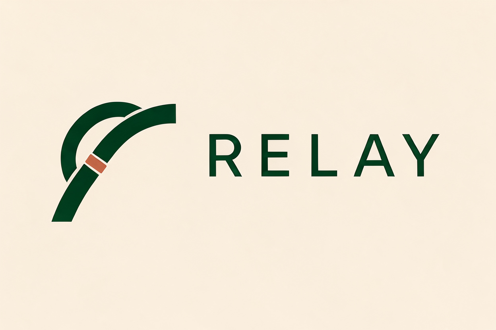

# Relay

**Commitment operations for Jira Service Management.** A case cannot close while it
still owes somebody something.



- **Demo video (1 min 50 s):** <YOUTUBE LINK>
- **Install on your Jira Cloud site:** <INSTALLATION LINK>
- Submitted to **Atlassian Codegeist 2026** — *Apps for Specialized Industries*

---

## The problem

A maintenance desk runs on promises. *"I'll fix the tap by Friday."* The promise is
made in a comment, the agent means it, and then the ticket gets closed anyway —
because Jira's idea of a case is its **status**, not its **obligations**. The tenant
is left chasing something nobody is tracking.

Relay makes the promise a first-class record with an owner and a date, and then
refuses the closure until the promise is settled.

## What it does

- **Capture.** Comments are scanned for commitments. Anything found arrives as a
  *proposal*, never as fact: a person accepts it, edits it, or drops it.
- **Verification.** A commitment closes only by verifying it, and verification
  carries evidence — what was done, by whom, when — recorded in the case trail.
- **Enforcement.** A workflow **validator** guards agent and REST closure and
  explains itself in a sentence a person can act on. A workflow **condition**
  guards the customer portal, which skips validators.
- **The console.** One page answers one question: *what needs a decision today* —
  past the date given, waiting on a person, no owner, or awaiting review.

## Try it

1. Install Relay from the link above onto a Jira Cloud site where you are an
   administrator. There is nothing to host and no credentials to issue — it is a
   Forge app.
2. Open any issue and click the **Relay** icon in the issue header to open the
   **Commitments** panel. (Forge panels start collapsed; it may be behind the
   **Apps** or **…** button.)
3. Click **Track**, then post a comment that reads like a promise, e.g.
   *"I'll fix the tap by Friday."* Click **Scan comments** and accept the proposal.
4. Open the status button: **`Resolved` is gone** — not greyed out, absent. Verify
   the commitment with a line of evidence, and it comes back.

**Honest limits, stated up front:** a fresh install deliberately enforces nothing
until an administrator attaches `Relay closure gate` (validator) and
`Relay closure readiness` (condition) to that project's workflow, and the portal
half of the enforcement requires Jira Service Management. Details in
[`docs/FIRST-RUN.md`](docs/FIRST-RUN.md).

## How the enforcement works

Two mechanisms, because one is not enough — and that is proven, not assumed. On the
demo site the **same transition refused an agent and admitted a customer**, because
the Jira Service Management portal skips workflow validators entirely.

| Half | Mechanism | Covers |
|---|---|---|
| Agent / REST closure | `jira:workflowValidator` | issue view, bulk actions, `POST /transitions` |
| Customer portal | `jira:workflowCondition` | portal transitions, which skip validators |

The condition is expression-only, so it cannot call Relay and cannot explain
itself. It reads an issue property Relay writes:

```
(issue.properties['relay.closure']['state'] == "unmanaged") ||
(issue.properties['relay.closure']['state'] == "managed" &&
 issue.properties['relay.closure']['open'] == 0)
```

Reading a **property** rather than a named custom field is what makes the condition
portable: a field id would bake in the site it was written on, so the same manifest
would fail to install anywhere else.

Enforcement is **fail-closed**. A missing property, an unknown state, a null count
or an expression error all refuse the transition. If Relay cannot prove a case is
clear, the case stays withheld, and the console says which half failed and why.

## How it is built

A Forge app for Jira Cloud — Node 22 runtime, React console in a static resource,
**no external service, no external database, no hosting of our own**.

| Module | What it does |
|---|---|
| `jira:issuePanel` | the Commitments console on a case |
| `jira:globalPage` | project-wide workspace: overview, capture inbox, activity, settings |
| `jira:workflowValidator` | Relay closure gate |
| `jira:workflowCondition` | Relay closure readiness (portal coverage) |
| `jira:customField` ×2 | read-only closure projection fields Relay owns |
| `avi:jira:created:issue` trigger | every new issue is recorded `unmanaged` at once, so nothing is refused for the wrong reason |

- **Ledger:** Forge Custom Entity Store, one record per issue, with **revision-guarded
  conditional writes** so two mutations can never fork a record.
- **Projection:** Forge issue properties, read by the workflow condition.
- **Codec:** `src/record-codec.js` is the encode/decode boundary — the entity store
  has no null of any type and rejects undeclared attributes, so nulls are stripped
  on write and restored on read, and the manifest and the codec are checked against
  each other.

## Repository map

```
app/
  manifest.yml     Forge modules, storage declaration, scopes
  src/             data access (jira.js), extraction, storage, ledger, projection,
                   gate, sync, audit, handlers, Forge binding (resolvers.js)
  test/            204 tests — npm test
  ui/              Custom UI (React + TS + Vite), own design system
  ui/src/screens/  Overview · Capture inbox · Case workspace · Activity · Settings
docs/              integration reports, runbooks, first-run findings, demo material
phase0/            technical validation: probe app, labelled benchmark, reports
```

## Run it locally

```
cd app && npm install && npm test
cd ui && npm install && npm run build        # emits app/static/relay
```

The UI alone can be served against a clearly flagged fixture workspace:

```
cd app/ui && npm install && npm run dev      # http://localhost:5180
npm run check:render                          # renders every screen, asserts content
npm run typecheck
```

Inside Forge the UI reads the real site; a failing bridge is an error screen, never
a silent fall back to fixtures.

## Deploy

From a machine with Forge credentials (manifest `app.id` is site-specific and is not
committed):

```
cd app && npm install && npm test && npm run check:manifest
cd ui && npm run build
cd .. && npx @forge/cli deploy && npx @forge/cli install --upgrade
```

## Documentation

| Document | What it is |
|---|---|
| [`docs/FIRST-RUN.md`](docs/FIRST-RUN.md) | what a fresh install actually does, observed — including the three defects a cold site found |
| [`docs/P2-INTEGRATION.md`](docs/P2-INTEGRATION.md) | the Jira integration: what is live-verified, documented-verified, inferred, untested |
| [`docs/P2.1-RUNBOOK.md`](docs/P2.1-RUNBOOK.md), [`docs/P2.2-RUNBOOK.md`](docs/P2.2-RUNBOOK.md) | deploy order, lint commands, rollback |
| [`docs/DEVPOST.md`](docs/DEVPOST.md) | the submission write-up |
| [`docs/DEMO-TIMING.md`](docs/DEMO-TIMING.md) | the shot list the demo video follows |

### Engineering log (historical)

These are the research and review documents the build was gated on. They are kept
because the reasoning still holds, but they describe the project *before* the app
existed — anything they say about application code is superseded by the sections
above.

| Document | Status |
|---|---|
| `RELAY-REVIEW-V2.1.md` | current at the time; superseded as a description of the product |
| `RELAY-V2.1-RISK-REGISTER.md` | every claim the build rested on, split into verified / third-party / inferred / untested |
| `RELAY-V2.1-LIVE-BLOCKERS.md` | the questions that needed a live site — all since answered |
| `RELAY-REVIEW-V2.md`, `RELAY-PRE-BUILD-RED-TEAM-REVIEW.md` | superseded |
| `CODEGEIST-2026-RESEARCH-REPORT.md` | competition and opportunity research |
| `phase0/` | probe app, 30-comment labelled benchmark, validation reports |

## Privacy and support

- [`PRIVACY.md`](PRIVACY.md) — what Relay stores and where
- [`SUPPORT.md`](SUPPORT.md) — how to get help

## License

MIT.
